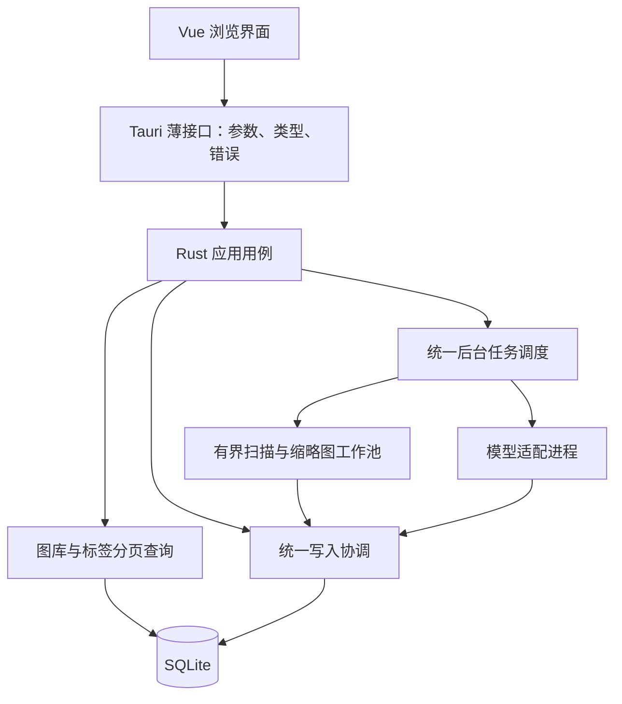

# 后端技术路线与彻底重构计划

2026-10-23；基线提交 `ca8187a`。产品唯一目的：本地标签式图片浏览。本轮为源码核对、技术选择与规划，不实施运行时代码变更。

## 结论与依据边界

推荐 **Rust 作为唯一业务核心，SQLite 作为本地事实存储，ONNX Runtime 执行模型，Python 暂时限定在可替换的模型适配进程中**。

彻底重构的对象是职责、数据流、任务所有权、存储事务和模型边界。现有证据不足以证明 Rust 已触及语言上限，也不足以证明 Python 包装层是主要推理瓶颈。本次没有测量真实图库耗时、内存或模型准确率，下面的性能影响均需要基线验证。

上次提交已经完成专用功能拆除与方向收敛；完整前端体验重制仍有待实施。本方案与既有前端计划对齐，不以它已经全部落地为前提。

## 现在使用的语言与技术

| 部分 | 实际技术 | 当前职责与证据 |
|---|---|---|
| 界面 | TypeScript、Vue 3、CSS；Windows WebView2 | 图片呈现、标签输入、交互状态；`package.json` 与 `src/` |
| 桌面与业务核心 | Rust，edition 2021；Tauri 2 | IPC、图库查询、标签与文件元数据、任务、缩略图、回收和恢复；`src-tauri/Cargo.toml` |
| 数据 | SQL、SQLite、rusqlite | schema 3 紧凑关系、标签反向索引、事务、任务记录；`library/compact_schema.sql` 与 `compact_indexes.sql` |
| 模型适配 | Python、NumPy、Pillow | 预处理、推理调用、输出处理，JSONL 子进程通信；`src-tauri/scripts/` |
| 模型数值执行 | ONNX Runtime 原生运行时，CPU/CUDA execution provider | `ort_runtime.py` 创建 session，模型服务调用 `session.run` |

Node/npm 是开发构建工具，不是当前业务后端。Python 调用了原生模型执行引擎，不能把整个模型耗时当成解释器耗时；语言变化也不能自动提高标签准确率。参见 [ONNX Runtime 架构](https://onnxruntime.ai/docs/reference/high-level-design.html)。

## 为什么保留这条语言路线

| 选择 | 对本项目的判断 |
|---|---|
| Rust | 当前首选。已与桌面壳、数据访问、文件处理和任务集成；适合控制资源与生命周期，继续投入能集中改善现有体验 |
| C++ | 能胜任核心与推理，当前没有同负载比较证明整体迁移有净收益；新增迁移与手工生命周期管理成本需要明确收益支撑 |
| C# / .NET | Windows 桌面也是合理路线，不应以“性能不够”排除；更适合已有 .NET 团队或整体桌面技术栈重新选择的情形。本项目单换后端会增加桥接和迁移成本 |
| Go / Node.js | 能实现元数据与调度业务，当前没有证据显示加入另一个运行时能解决现有的候选物化、写入协调或状态所有权问题 |
| Python 作为全部业务核心 | 可以实现本地应用，但目前已有 Rust 业务基础；不建议把存储、调度与前台查询再迁入 Python |
| Python 作为模型适配器 | 先保留并规范；适合快速核实和迭代模型契约。是否去掉由预处理、通信、启动、包体和维护成本的实测决定 |

以上是结合当前代码和维护成本作出的工程判断，不是语言速度排行榜。Rust 的所有权机制在编译期管理内存约束，但不会自动防止数据库互锁、无界队列或逻辑竞态。[Rust 所有权说明](https://doc.rust-lang.org/book/ch04-01-what-is-ownership.html)。.NET 也有原生 AOT 部署能力，语言选择不能简化为“原生语言一定够、托管语言一定不够”。[Microsoft Native AOT](https://learn.microsoft.com/en-us/dotnet/core/deploying/native-aot/)。

SQLite 的官方定位包含桌面应用与本地数据存储。百万图片的数量本身不能证明需要服务器数据库；还要考虑标签关系数、选择率、索引、分页、写入节奏和存储设备。[SQLite 适用范围](https://www.sqlite.org/whentouse.html)。

## 源码已经证实的结构

| 证据 | 事实 | 重构意义 |
|---|---|---|
| `library.rs:115` | AppState 同时拥有数据库、全局写锁、任务、图库/向量缓存、多组 worker 布尔状态和模型进程 | 状态所有权按职责拆开，消除业务层随意操作其他模块内部状态的路径 |
| `commands.rs:16,1251`、`library/api.rs:279,313` | 已有 spawn_blocking 与写锁；写入保护位于不同层 | 保留阻塞工作离开主线程的做法，集中写事务入口 |
| `commands.rs:289–410`、`main.rs:671–691` | 统一 jobs 之外，仍注册可直接启动/控制 worker 的接口 | 建立实际调用清单，长任务统一进入同一调度与控制入口 |
| `library/api.rs:190–232`、`tag_search.rs:271` | 标签筛选先收集全部候选 ID；随机查询还整体排序，然后截取一页 | 优先改数据库侧分页与稳定顺序，减少每页重复收集/排序，不靠换语言隐藏成本 |
| `library/storage.rs:3–38` | 常规操作会打开连接并配置 busy timeout、缓存和 mmap；入口不显式选择 WAL | 将初始化、读连接、写连接与容量预算集中管理；实际 journal 模式需要单独核实 |
| `storage.rs:823`、`gallery.rs:115` | 普通图库和旧快照已有限制首批 5000 张；不是当前启动把全部图片 DTO 送到前端 | 保留有界接口，不能沿用“当前启动全库加载”的错误诊断 |
| `compact_indexes.sql:43`、`compact_schema.sql:235` | 已有整数键、字符串驻留、标签反向索引与统计 | 复用有效格式，先验证查询计划；不为换 ORM 重建全部数据 |
| `api.rs:241` | 分步查询后再读取内存 revision，尚无统一的页面数据与版本快照契约 | 定义页内一致性、跨页变化与失效恢复，避免旧数据附上较新版本 |
| `jobs_store.rs:230`、`scan.rs:509` | 已有先保存后发布状态与对前台让步的机制 | 保留正确语义，整合调度所有权，而不是全部丢掉 |
| `inference.rs:50`、`search.rs:29` | 可选自然语言检索存在全量向量缓存及持锁遍历 | 从标签浏览热路径隔离，实测冷加载、锁与内存后再优化 |

路径相对 `src-tauri/src/`。这些结构不等于已经量化的性能瓶颈。`cache_size=-262144` 约为每连接 256MiB 的建议页缓存预算，不是立即分配；8GiB mmap 上限也不等于 8GiB 物理内存占用。[SQLite PRAGMA 说明](https://sqlite.org/pragma.html#pragma_cache_size)。

## 目标结构：本地模块化核心

这是同一个本地应用内的职责划分，模型进程是明确的故障隔离边界，不拆成网络微服务。

- **接口层**只处理 IPC 参数、DTO 和错误映射。沿用 Rust 生成 TypeScript 契约，减少双向手写漂移。
- **应用用例**表达查询、收藏、修改标签、删除/恢复、启动处理等产品动作，不直接管理管道和 SQL 连接细节。
- **图库与标签查询**负责作用域、英文稳定键、中文映射、分页与计数；普通图库和标签结果共享查询语义。
- **写入协调**管理主库写事务、数据版本、缓存失效和提交后事件，后台与前台写入使用同一规则。
- **任务调度**是长任务状态的唯一所有者，统一资源限额、暂停、取消、重试和关闭。
- **媒体与模型适配**只提交有版本依据的结果，不自行修改任务终态或图库全局状态。

先按模块建立边界，只有确有独立编译或测试收益再拆 crate。外部原图保持文件方式读取，IPC 以有界元数据为主，图片显示继续使用受控资源路径。

## 查询与存储规则

1. 前端传入统一查询规格，后端规范化标签、范围和排序。内部用 ImagePk、ImageId、ImagePath、TagKey 等独立类型，避免同为字符串就可互换；已有对外 ID 不重新编号。
2. 标签条件下推 SQL，先定位符合条件的一页，再加载这一页的展示数据。保留人工补充和自定义标签的既有搜索含义。
3. 对适合稳定排序的路径采用复合游标，包含排序值与唯一键；首屏与深页均测试。不能只把 OFFSET 改名为 cursor。
4. 随机浏览单独定义种子、顺序、翻页和版本规则。先做对照原型，再选择有容量限制的会话/索引策略，避免每页重排全库；不以随机抽样冒充全结果浏览。
5. count、页数据和 revision 具有明确的一致性来源。跨页发生更新时规定如何过期、重取并恢复图片锚点；不为整个浏览会话持有长读事务，也不因无关后台更新反复打断浏览。
6. 读连接数量与资源预算有界，数据库初始化/检查独立于每次普通读取。集中写入，文件扫描、解码和推理都在写事务之外；提交批次按延迟与吞吐实测确定。
7. WAL 是本地数据库读写并发的优先实验方向：先核对打包 SQLite 的具体版本/修复、文件系统、备份/恢复和 checkpoint 策略，再在隔离样本中比较，不直接修改生产库。WAL 仍只有一个 writer；长读事务会妨碍 checkpoint，跨多个附加库也不保证整组原子性。[SQLite WAL](https://www.sqlite.org/wal.html)。
8. 主库 schema 3 和有效反向索引先保留。若人工标签语义或新契约确实需要结构变化，再单独设计迁移与回滚；不靠清空重建图库完成重构。

## 任务与资源规则

- 前台查询与交互写入优先；后台也要有最低进展机会，避免连续浏览让打标永久饥饿。
- CPU 解码、磁盘与模型设备分别有有界并发和队列。各功能不能独自创建一套不受整体约束的工作池。rusqlite 与图像解码继续在受限阻塞工作线程执行，不因改 async 就搬到异步运行时线程上。
- 旧 worker 的布尔状态收敛为明确任务状态机；Tauri、jobs 和 worker 不同时充当控制者。内部阶段仍可复用已有算法。
- 进度、暂停请求、暂停完成、取消和终态含义固定。任务结果先持久化，再发布；终态保存失败只重试保存，不重跑已完成处理；重启后不自动执行中断任务。
- 每个结果绑定图片 ID、源版本、模型契约版本和请求代次，提交前复核；过期结果不覆盖较新源或人工意图。
- 进程启动、响应、停止和回收均有期限。迟到、乱序、损坏和过大协议响应可以识别；内存队列有界不代表单帧大小已经有界。
- 普通回收站涉及文件与多个日志库，保留意图记录和故障恢复。不能把文件操作声称为单个 SQLite 事务可回滚的动作，也不承诺外部副作用天然“恰好一次”。

## 模型层的重构决策

先统一模型契约与策略所有权：输入方向/透明/色彩、尺寸/填充/插值、张量布局和归一化、词表顺序、logit/分数转换、实际阈值、provider 和版本。当前 Rust 传入 0.35/0.85，而 Python 默认 0.2/0.2 且配置优先，必须给出唯一有效配置来源，不能在两边各保留一套看似生效的策略。

Python 第一阶段只保留模型特定预处理、原生引擎调用及必要后处理；业务准入和人工标签合并由 Rust 核心负责。自动结果、人工补充与人工排除的语义要明确，不能把自动更新当成覆盖人工修正的许可。

不在全库保存完整词表的全部 logits 来换取任意阈值调节；校准样本可以保留完整输出，图库保存发布结果、必要分数与契约记录。阈值放宽涉及原先没有保存的标签时，需要明确重处理范围。

只有当基线证明启动、Python 预处理、通信、包体或维护成本值得迁移时，才制作 Rust 推理适配器原型。可通过经过验证的绑定/C API 调用相同 ONNX Runtime，必要时仍保持独立进程隔离。采用条件为：相同模型与输入的张量/输出在声明容差内一致，标签集合与人工优先规则正确，端到端资源与响应具有净收益。仅“Rust 写成了”不能作为通过条件。

## 实施批次与退出条件

| 批次 | 内容 | 通过条件 |
|---|---|---|
| B0 基线和接口清单 | 记录所有实际 invoke、数据库读写、worker 启动、资源与模型契约；建立隔离查询样本 | 得到可重复的当前行为、延迟分解和真值；未知项明确列出 |
| B1 核心边界 | 独立业务类型、统一查询规格/错误/DTO、应用服务；Tauri 只适配 | 核心用例可脱离 AppHandle 测试；已有 UI 行为与对外 ID 保持可核对 |
| B2 存储与写入 | 集中连接策略、读写职责、事务、revision、失效与提交后事件；WAL 对照实验 | 写入/读取并发和故障恢复通过；没有持库锁做模型/解码或控制回调 |
| B3 浏览查询 | 数据库侧分页、标签反向定位、游标、计数、随机顺序与版本规则 | 首屏/深页/多标签真值一致，资源有界；不逐页全量收集和重排候选 |
| B4 统一调度 | 长任务唯一入口、状态所有权、资源预算、取消/关闭与结果保存 | 无绕过调度的可执行旧入口；任务与 UI 状态一致；后台运行时前台延迟达预算 |
| B5 标签与模型 | 单一有效契约、源/模型版本、人工意图、假服务与边界验证；有证据再做原生原型 | 故障/重启/过期结果不丢保存或覆盖人工结果；输出可复现，实际 provider 可诊断 |
| B6 清理与交付 | 删旧路径、旧状态与无调用入口；检查备份/迁移、便携资源和普通回收 | 没有长期并存的两套主控；回归与性能条件通过，包体/依赖有清单 |

B1～B6 以垂直用例逐个切换：先“组合标签并返回一页图片”，再“用户修改”，最后“后台打标提交”。接口适配只作为切换手段，完成后移除旧实现，不在新后端内包住整个旧 AppState 作为永久依赖。

## 验收方法

| 维度 | 场景与判定 |
|---|---|
| 查询真值 | 1万/10万/100万隔离元数据；高频、低频、长尾、中文映射、自定义/补充、收藏/分类/回收、多标签交集；答案来自生成规则，不只比较数量 |
| 规模 | 同时记录标签关系数和分布。百万图片配少量标签的测试不能代表数千万关系、偏斜热词的真实压力 |
| 响应 | 拆开排队、SQL、锁等待、反序列化与 IPC；记录冷/热中位数、P95/P99与最慢请求，比较无后台和打标/缩略图并行时表现 |
| 初始预算 | 用户动作后100ms内可见接收反馈作为前后端联合候选目标；热索引常用标签首屏后端 P95 200ms作为候选，均由B0固定硬件与负载后修订，不冒充承诺或实测 |
| 内存与I/O | 连接/缓存、候选/向量、已解码图片、Python tensor分开记账；记录进程private bytes、工作集和GPU口径，不将mmap虚拟范围当RSS |
| 恢复 | 真正假子进程EOF/挂起/异常帧、写锁、低空间、崩溃前后、源文件替换、模型版本变化、取消与迟到结果、终态保存失败 |
| 标签质量 | 合成张量与假服务验证契约；语义质量使用经授权的分层人工真值，评估误标、漏标、校准和找图效果，不用合成素材宣称准确率 |
| 用户路径 | 标签组合→滚动→开图→加标签→返回；前台修改与后台提交同时发生；Delete/Undo、普通回收/恢复、备份/迁移；只用headless合成页面 |

不为普通界面/后端修改生成百万张高分辨率原图或复制大型模型。规模与硬件门禁、采样方法和未完成档位明确记录。每批先通过正确性与故障测试，再证明延迟或资源收益。

## 完成定义与当前状态

完成意味着：职责能独立验证，前台延迟可解释，读写与状态版本一致，后台资源有界，模型输出可追溯，人工意图受保护，旧活动路径已退役。

本轮已经完成源码只读核对、两名子代理的存储/推理事实整理及一手资料核实；只新增规划文档。没有修改业务实现、运行模型、触碰生产数据库或启动正式窗口。当前98项Rust库/4项程序/53项前端的通过结果属于前次已提交基线，不是本轮新跑的重构回归。
